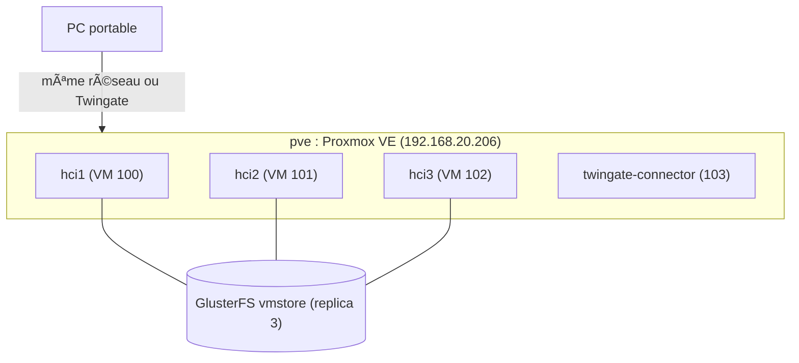

# Architecture

## Réseaux

| Pont Proxmox | Réseau | Rôle |
|---|---|---|
| vmbr0 | 192.168.20.0/24 (ESGI LAB) | Internet, accès SSH et interface web de pve |
| vmbr1 | 10.10.10.0/24 (privé, isolé) | Cluster : SSH, Ansible, Gluster, migration |
| vmbr2 | 192.168.100.0/24 (NAT + DHCP) | VM invitées, vues par les nœuds via br0 |

## Briques

| Brique | Choix | Rôle |
|---|---|---|
| OS | Ubuntu Server 24.04 LTS | Base des 3 nœuds |
| Hyperviseur | KVM/QEMU + libvirt | Exécution des VM |
| Stockage distribué | GlusterFS, volume vmstore replica 3 | Disques des VM copiés sur 3 nœuds |
| Déploiement | Ansible | Cluster reproductible depuis hci1 |
| Management | hcictl (bash) | Création, migration, évacuation, failover |
| Réseau | Bridge br0 (netplan) | Réseau des VM invitées |
| Accès à distance | Twingate | Travail hors du labo |
